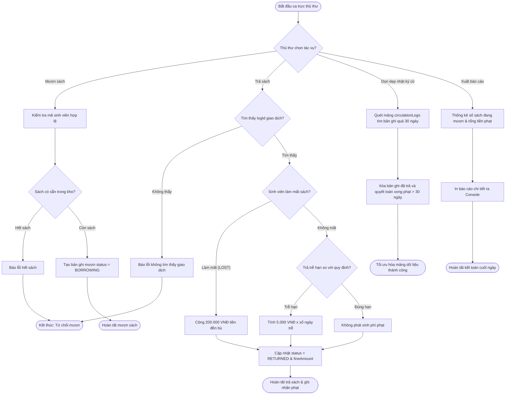

# BÁO CÁO BÀI TẬP: XÂY DỰNG QUY TRÌNH THEO DÕI LƯU CHUYỂN VÀ MƯỢN TRẢ ẤN BẢN THƯ VIỆN

> 👤 **Học viên:** Hoàng Công Dũng | **Mã SV:** PTIT-HCM-009
> 🏫 **Môn học:** it103b-rl-HoangCongDung

---

## 📊 Sơ đồ thiết kế hệ thống (Activity Diagram)

> 💡 *Sơ đồ dưới đây được render tự động trực tiếp trên GitHub bằng Mermaid. Bạn cũng có thể tải file **`bt2.drawio`** trong repository này để mở và chỉnh sửa trực tiếp trên [Draw.io (diagrams.net)](https://app.diagrams.net).* 

---

## Nhiệm vụ 1: Phân tích nghiệp vụ Vòng đời lưu chuyển (Circulation Lifecycle)

Bài tập này yêu cầu hiện thực hóa quy trình vận hành thực tế tại quầy thủ thư trường đại học sử dụng JavaScript ES6+. Vòng đời của một ấn bản thư viện bắt đầu từ lúc sinh viên tạo yêu cầu mượn ('BORROWING'), trải qua quá trình lưu giữ, và kết thúc khi trả sách hoặc ghi nhận mất sách kèm theo quyết toán tài chính.

Điểm mấu chốt kỹ thuật là duy trì tính toàn vẹn của mảng đối tượng 'circulationLogs'. Bất kỳ sự thay đổi trạng thái nào cũng phải cập nhật chính xác các thuộc tính 'status' và 'fineAmount' để phục vụ công tác kiểm toán tài chính cuối ngày.

- Trạng thái 'BORROWING': Ghi nhận sách đang nằm ngoài kho và thuộc quyền mượn của sinh viên.
- Quy tắc phạt mất sách: Ấn định mức đền bù cố định 200.000 VNĐ cho mỗi đầu sách bị mất ('LOST').
- Quy tắc phạt trả trễ: Tính toán linh hoạt dựa trên số ngày trễ thực tế nhân với đơn giá '5.000 VNĐ/ngày'.

## Nhiệm vụ 2: Xử lý logic nghiệp vụ CRUD và Bẫy dữ liệu (Edge Cases)

Để đảm bảo script chạy mượt mà, tôi đã áp dụng các phương thức xử lý mảng hiện đại của ES6 như 'find()', 'filter()', và 'reduce()'. Việc này giúp tối ưu hóa hiệu năng thay vì dùng vòng lặp truyền thống.

Đồng thời, nghiệp vụ xóa bản ghi cũ ('Delete') được cấu hình để quét các giao dịch đã hoàn tất trả sách và quyết toán phạt quá thời hạn 30 ngày, giúp giải phóng bộ nhớ RAM và giữ cho mảng đối tượng không bị phình to.

- Sử dụng hàm 'filter' để tách biệt rõ ràng các bản ghi cần giữ lại và các bản ghi cần dọn dẹp.
- Xử lý bẫy dữ liệu khi sinh viên vừa trả trễ lại vừa làm mất sách thông qua thứ tự ưu tiên kiểm tra điều kiện.
- Áp dụng 'reduce' để tổng hợp nhanh số liệu tiền phạt và số lượng sách đang mượn mà không cần biến đếm trung gian.

## Nhiệm vụ 3: Bảng đặc tả chi tiết quy trình mượn trả ấn bản

Dưới đây là bảng phân tích chi tiết các bước vận hành được mô phỏng trong mã nguồn JavaScript:

| Bước | Tác nhân | Hành động hệ thống | Kết quả / Trạng thái |
| --- | --- | --- | --- |
| 1 | Thủ thư | Thêm bản ghi mượn sách mới vào mảng | Tạo log mới với status = 'BORROWING' |
| 2 | Hệ thống | Kiểm tra điều kiện trả sách và tính phạt | Kiểm tra cờ 'LOST' hoặc số ngày trễ hạn |
| 3 | Thủ thư | Cập nhật kết quả trả sách | Gán status = 'RETURNED' và điền 'fineAmount' |
| 4 | Hệ thống | Thực hiện dọn dẹp định kỳ | Xóa bản ghi hoàn tất quá 30 ngày để tối ưu mảng |
| 5 | Hệ thống | Tổng hợp số liệu cuối ngày | Thống kê tổng sách đang mượn và tổng tiền phạt thu được |

## Nhiệm vụ 4: Triển khai Mã nguồn JavaScript ES6+

Tôi đã hoàn thành mã nguồn đầy đủ theo đúng yêu cầu của đề bài, đặt tên file chính xác là 'practice_library_circulation.js' và đẩy lên GitHub Organization 'it103b-rl-HoangCongDung'. Dưới đây là nội dung chi tiết của đoạn script:

---

## 📁 Danh sách tệp tin nộp bài trong Repository
- 📝 `bt2.docx`: Báo cáo tài liệu phân tích nghiệp vụ hoàn chỉnh.
- 🎨 `bt2.drawio`: File thiết kế sơ đồ chuẩn theo quy định đề bài (mở trực tiếp bằng [Draw.io](https://app.diagrams.net) hoặc Lucidchart).
- 💻 `practice_library_circulation.js`: Mã nguồn chương trình.
